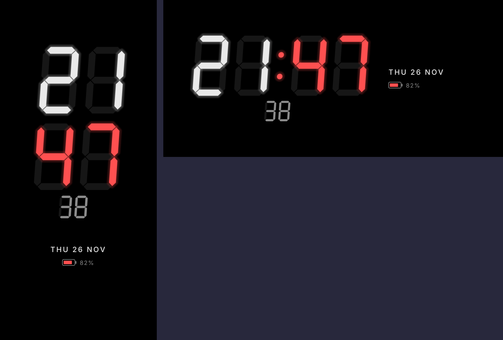
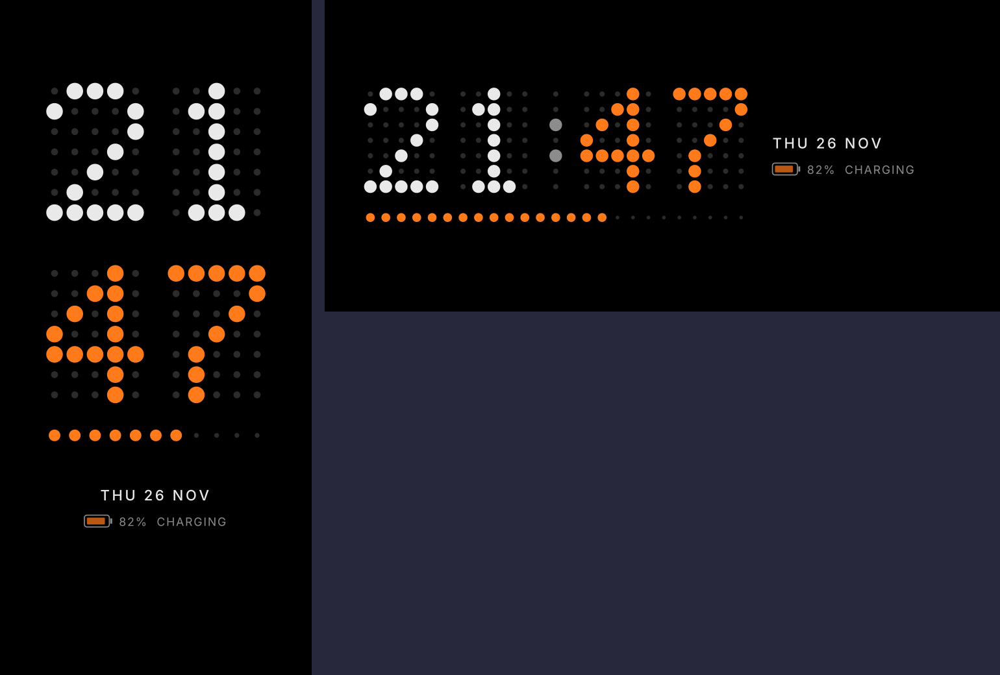
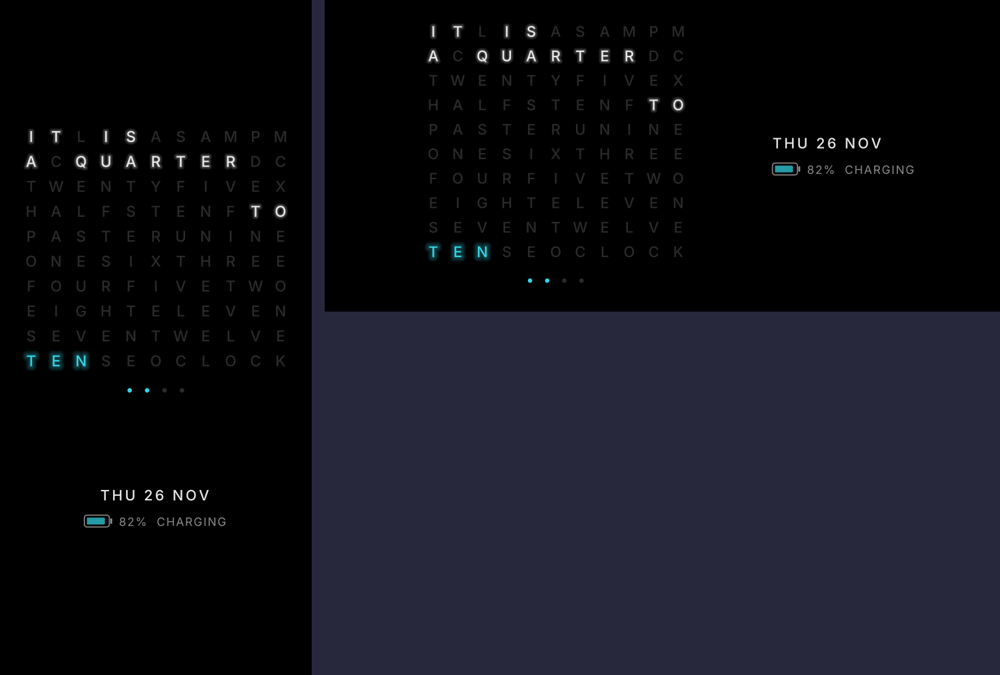
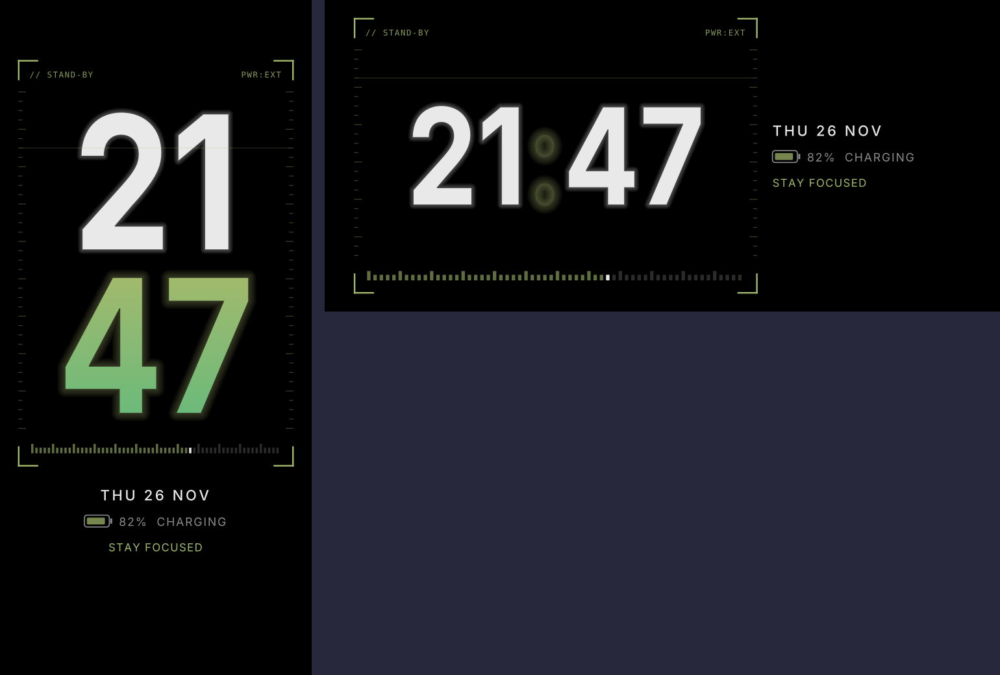

# Stand

A clock display for a phone on a stand. Made for the Galaxy S25 Ultra.

- 12 themes: Tactical, Orbit, Flip, Minimal, Space, Dots, LED, Words, Analog, Neon, Mega, Radar.
- Animated backgrounds: stars, fireflies, neon grid, waves, pulse.
- 11 colours and a custom colour slider. Glow, colour gradient, and 7 clock fonts.
- Shows the time, date, battery level, your own text, the song that plays, and notification icons.
- Turns to vertical or horizontal with the tilt sensor. Auto-rotate can stay off.
- Black background and few lit pixels, for low power on an AMOLED screen.
- On battery, the screen updates one time each second (or each minute if seconds are off).
  When the phone charges, the animation is smooth.
- Night mode (dim or red) from 22:00 to 06:00.
- The settings screen has a live preview.

The pictures in `docs/` are preview renders from a computer. Fonts and glow on the phone are a little different.

## Install

There are two files on the **Releases** page ("Latest build"):

| File | Music and notification icons | Install |
| --- | --- | --- |
| `stand.apk` (Lite) | No | Download on the phone and open it. |
| `stand-full.apk` (Full) | Yes | Google Play Protect blocks it from a browser in some countries. Install it from a computer: `adb install -r stand-full.apk` |

Both files use the same key. You can install one on top of the other and keep your settings.

## Use

| Action | Result |
| --- | --- |
| Swipe left / right | Change the theme |
| Swipe up / down | Change the colour |
| Touch and hold | Open the settings |
| Double-tap | Play / pause the music |

## Music and notification icons

These are only in the Full version. They need "notification access".

1. Touch and hold the screen to open the settings. Tap **Notification access**.
2. If the phone shows "Restricted setting": open Settings > Apps > Stand > the 3 dots > **Allow restricted settings**. Then do step 1 again.

## Screensaver

The app can also start by itself when the phone charges.
In the app settings, tap **Use as screensaver** and select **Stand**.

## Build

Each push builds the APK with GitHub Actions (`.github/workflows/build.yml`).
To build on a computer with the Android SDK: `gradle :app:assembleDebug`.
