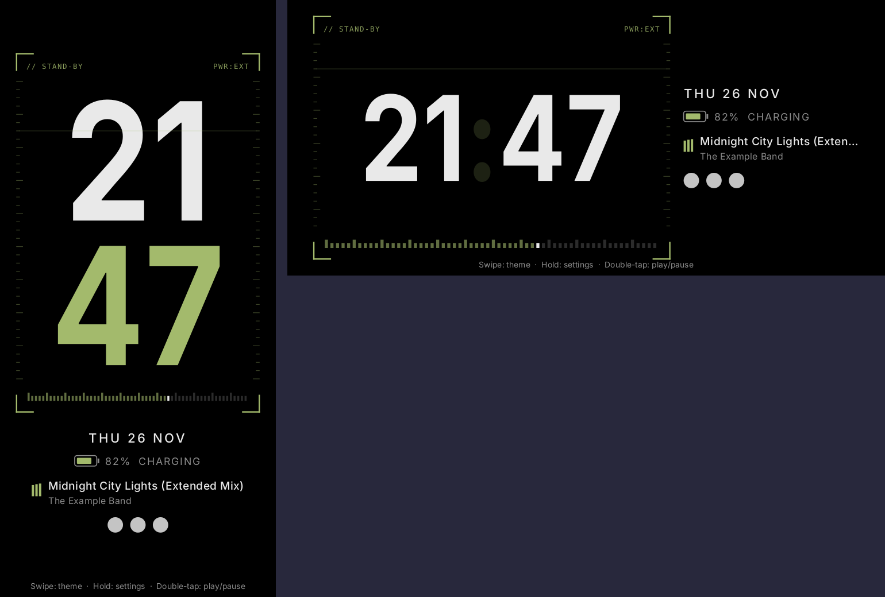

# Stand

A clock display for a phone on a stand. Made for the Galaxy S25 Ultra.

- 5 themes: Tactical, Orbit, Flip, Minimal, Space. Swipe left or right to change.
- Shows the time, date, battery level, the song that plays, and notification icons.
- Turns to vertical or horizontal with the tilt sensor. Auto-rotate can stay off.
- Black background and few lit pixels, for low power on an AMOLED screen.
- On battery, the screen updates one time each second (or each minute if seconds are off).
  When the phone charges, the animation is smooth.

The pictures in `docs/` are preview renders from a computer. Fonts on the phone are a little different.

## Install

1. On the phone, open the **Releases** page of this repository and download `stand.apk` from "Latest build".
2. Open the file and permit the install.
3. Open **Stand**.

## Use

| Action | Result |
| --- | --- |
| Swipe left / right | Change the theme |
| Touch and hold | Open the settings |
| Double-tap | Play / pause the music |

## Music and notification icons

These need "notification access".

1. Touch and hold the screen to open the settings. Tap **Notification access**.
2. If the phone shows "Restricted setting": open Settings > Apps > Stand > the 3 dots > **Allow restricted settings**. Then do step 1 again.

## Screensaver

The app can also start by itself when the phone charges.
In the app settings, tap **Use as screensaver** and select **Stand**.

## Build

Each push builds the APK with GitHub Actions (`.github/workflows/build.yml`).
To build on a computer with the Android SDK: `gradle :app:assembleDebug`.
