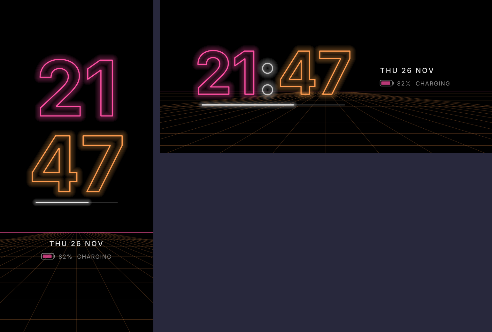
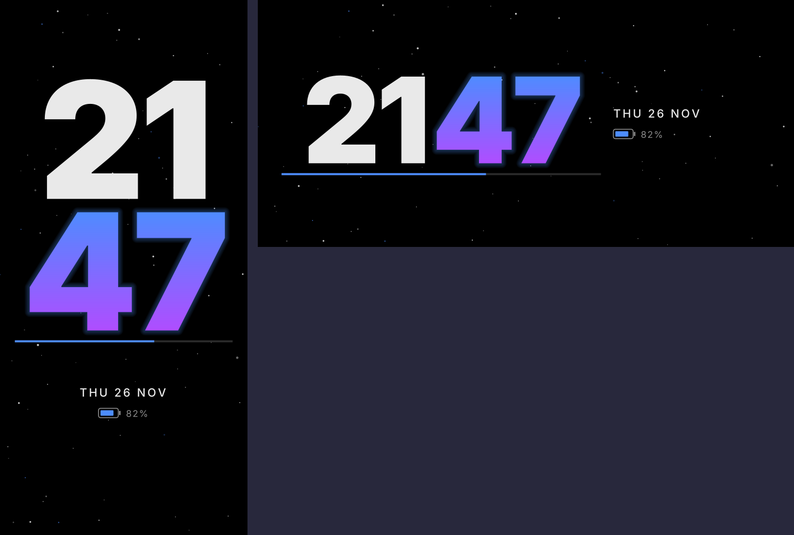
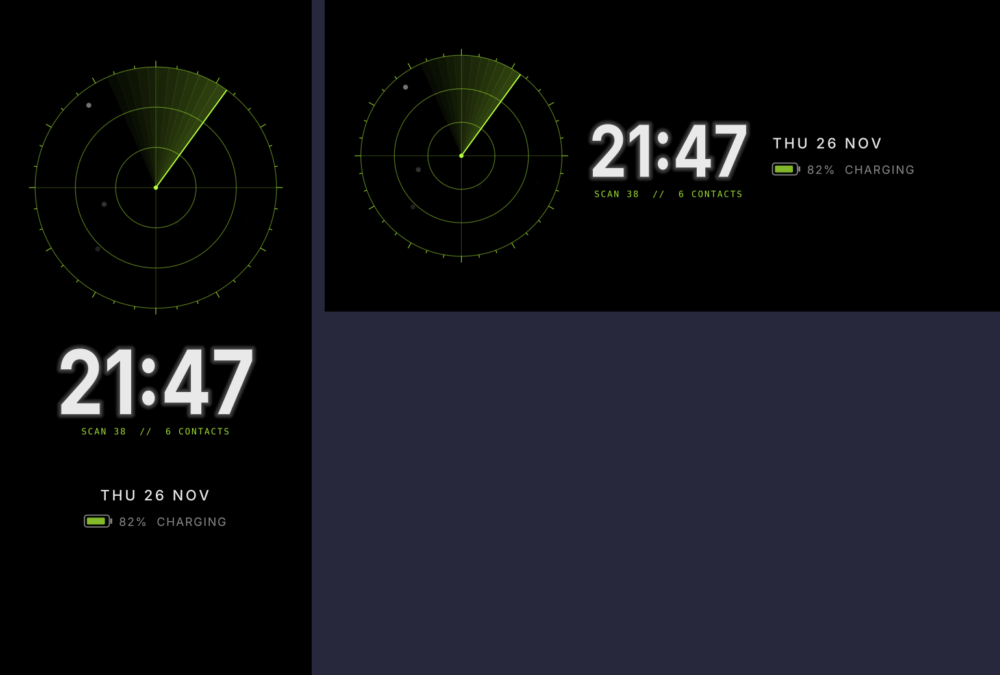

# Stand

A clock display for a phone on a stand. It works on phones and tablets with Android 8.0 or later. All sizes use the screen size, so the layout fits each screen.

- 12 themes: Tactical, Orbit, Flip, Minimal, Space, Dots, LED, Words, Analog, Neon, Mega, Radar.
- Animated backgrounds: stars, fireflies, neon grid, waves, pulse.
- 11 colours and a custom colour slider. Glow, colour gradient, and 7 clock fonts.
- Shows the time, date, battery level, your own text, the song that plays, and notification icons.
- Turns to vertical or horizontal with the tilt sensor. Auto-rotate can stay off.
- Black background and few lit pixels, for low power on an AMOLED screen.
- On battery, the screen updates one time each second (or each minute if seconds are off).
  When the phone charges, the animation is smooth.
- Night mode (dim or red) from 22:00 to 06:00.
- The settings screen has a live preview.






The pictures in `docs/` are preview renders from a computer. Fonts and glow on the phone are a little different.

## Install

There are two files on the **Releases** page ("Latest build"):

| File | Music and notification icons | Install |
| --- | --- | --- |
| `stand.apk` (Lite) | No | Download on the phone and open it. |
| `stand-full.apk` (Full) | Yes | Google Play Protect blocks it from a browser in some countries. Install it from a computer: `adb install -r stand-full.apk` |

Both files use the same key. You can install one on top of the other and keep your settings.

## Use

| Action | Result |
| --- | --- |
| Swipe left / right | Change the theme |
| Swipe up / down | Change the colour |
| Touch and hold | Open the settings |
| Double-tap | Play / pause the music |

## Music and notification icons

These are only in the Full version. They need "notification access".

1. Touch and hold the screen to open the settings. Tap **Notification access**.
2. If the phone shows "Restricted setting": open Settings > Apps > Stand > the 3 dots > **Allow restricted settings**. Then do step 1 again.

## Screensaver

The app can also start by itself when the phone charges.
In the app settings, tap **Use as screensaver** and select **Stand**.

## Build

Each push builds the APK with GitHub Actions (`.github/workflows/build.yml`).
To build on a computer with the Android SDK: `gradle :app:assembleDebug`.

## Signing key

Without a key, the build publishes debug APKs. They use a public test key, which is not safe for a public release.
To sign the APKs with your own private key, do these steps one time on a computer:

1. Make the key (Java must be installed). Use a strong password and keep the file safe:

   ```
   keytool -genkeypair -v -keystore release.jks -alias stand -keyalg RSA -keysize 4096 -validity 10000
   ```

2. Change the file to text:

   ```
   base64 -w 0 release.jks > release.txt        # Linux
   base64 -i release.jks -o release.txt         # macOS
   ```

3. In GitHub, open the repository Settings > Secrets and variables > Actions. Add these 4 secrets:

   | Secret | Value |
   | --- | --- |
   | `KEYSTORE_BASE64` | The contents of `release.txt` |
   | `KEYSTORE_PASSWORD` | The keystore password |
   | `KEY_ALIAS` | `stand` |
   | `KEY_PASSWORD` | The key password (usually the same as the keystore password) |

4. Push a commit to `main`, or start the "Build APK" workflow by hand.

Keep a copy of `release.jks` and the password in a safe place. If you lose them, users cannot update the app.
Do not put `release.jks` in the repository.

A change of key makes the old installed app incompatible. Uninstall the old app one time.

## F-Droid

- `fastlane/metadata/android/en-US/` has the store text, the icon and the screenshots.
  The screenshots are computer renders. Replace them with real ones before the first release.
- `docs/fdroid/io.github.beingmechon.stand.yml` is a draft of the F-Droid build recipe.
- F-Droid builds the `lite` flavour: `./gradlew :app:assembleLiteRelease`.

## Licence

GPL-3.0-only. See `LICENSE`.
